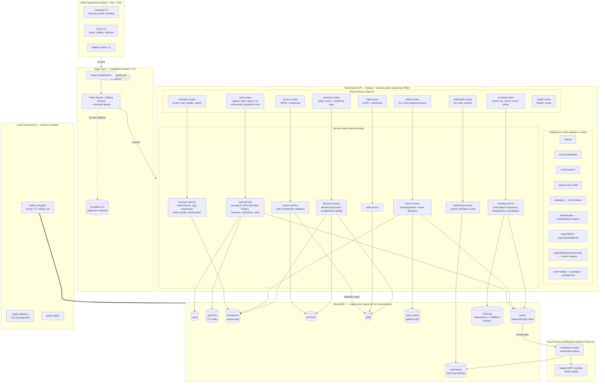
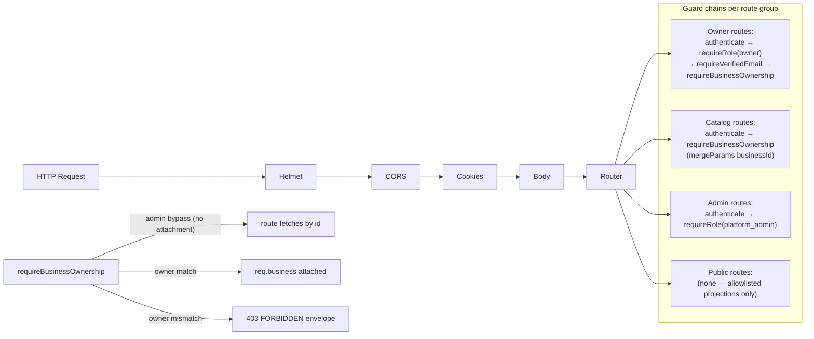
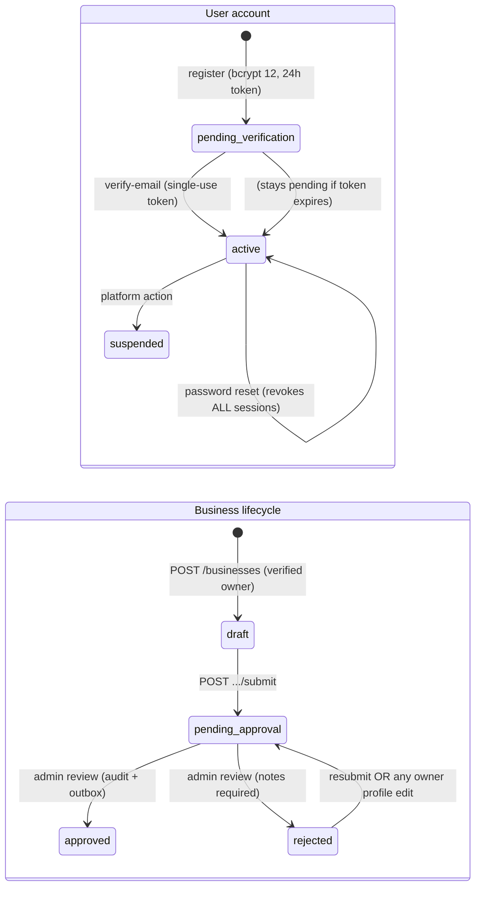

# Slotify — Application Architecture Diagram

**Document:** `docs/implementation-log/architecture-diagram.md`
**Status:** As-built after Phase 05
**Rendered with:** Mermaid — paste into any Mermaid-enabled viewer (GitHub renders it natively)
**Convention:** solid arrows = implemented and verified; dashed borders/arrows = planned, not yet implemented (Phase 06+)

---

## 1. Full System Architecture

## 2. Request Path Through the Middleware & Guards

## 3. Auth & Lifecycle State Machines

## 4. Data Notes (as built)

- **Tenant isolation:** every business-owned collection row carries `businessId`; owner routes resolve through `requireBusinessOwnership`.
- **Indexes (created at boot in `db/mongo.js`):** unique user email; unique session token hash + TTL; unique business slug; services/staff by business+active; unique booking idempotency; bookings by business/status/time and customer/time; outbox processing; audit by business/time; restrictions lookup.
- **Outbox pattern:** registration/verification, password reset, admin review, booking confirmation, and booking cancellation write outbox events; the Phase 5 worker polls them, creates idempotent notifications, and sends SMTP mail.
- **Implemented:** availability engine and booking transaction (Phases 3–4), polling notification worker and client notification center (Phase 5).
- **Planned (dashed):** Edge rate limiting (Phase 6), owner/admin client portals (Phase 7), evaluation seed package (Phase 8).
