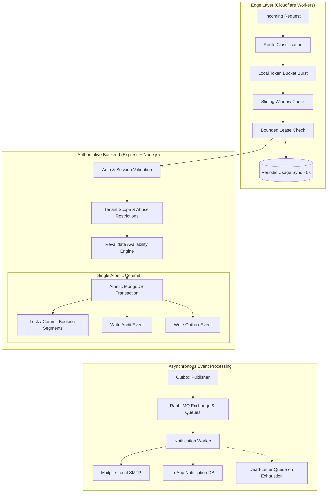

# Phase 00 — Repository Audit & Baseline Verification

**Document:** `docs/implementation-log/phase-00-repository-audit.md`  
**Phase:** 00 — Repository Inspection & Baseline Audit  
**Status:** Completed (Pending Review & Approval)  
**Execution Date:** 2026-10-15  
**Lead Engineer:** Antigravity (Lead Full-Stack Engineer)

---

## 1. Executive Summary & Objective

The objective of **Phase 00** is to perform a comprehensive, non-destructive repository audit of the Slotify project prior to generating any application code. This inspection encompasses:
- Git repository state, untracked artifacts, and directory topology.
- Verification of language compliance: validating strict adherence to **JavaScript** across all tiers (Frontend React/Vite, Backend Node.js/Express, Cloudflare Workers, background jobs/scripts) and checking for any preexisting TypeScript files or configuration.
- Audit of installed design intelligence skills, specifically the **UI/UX Pro Max** skill (`.agents/skills/ui-ux-pro-max/`), testing its execution and reconciling it with `docs/ui-ux.md`.
- Evaluation of documentation invariants across `docs/` (`AGENTS.md`, `README.md`, `requirements.md`, `architecture.md`, `decisions.md`, `data-api.md`, `rate-limiting.md`, `security.md`, `testing-operations.md`, `implementation-phases.md`, and `open-questions.md`).
- Assessment of local runtime tooling, system environment, container engines, and infrastructure dependencies.
- Identification of inconsistencies, architecture gaps, operational prerequisites, and a concrete recommendation for the initial code implementation phase.

**Result:** Zero application code was modified. All verification commands were executed and recorded. The repository is verified clean of any TypeScript files. Prerequisites and the roadmap for Phase 01 are established.

---

## 2. Git Status & Repository Topology

### 2.1 Git State
- **Branch:** `main`
- **Commit History:** Fresh repository (`No commits yet`).
- **Working Tree:**
  ```text
  Untracked files:
    .agents/
    docs/
  ```

### 2.2 Directory Hierarchy
```text
Slotify/
├── .agents/
│   └── skills/
│       ├── banner-design/
│       ├── brand/
│       ├── design/
│       ├── design-system/
│       ├── slides/
│       ├── ui-styling/
│       └── ui-ux-pro-max/
└── docs/
    ├── AGENTS.md
    ├── README.md
    ├── architecture.md
    ├── data-api.md
    ├── decisions.md
    ├── implementation-phases.md
    ├── open-questions.md
    ├── rate-limiting.md
    ├── requirements.md
    ├── security.md
    ├── testing-operations.md
    └── ui-ux.md
```

### 2.3 Observations on Existing Tree
1. **Missing Root Entry Points:** Neither `package.json`, `.gitignore`, `.env.example`, nor a root-level `README.md` / `AGENTS.md` exists at the workspace root. Both `README.md` and `AGENTS.md` are housed within `docs/`.
2. **Missing Application Structure:** No source directories (`src/`, `server/`, `client/`, `apps/`, or `workers/`) exist yet.
3. **No Build or Container Manifests:** `docker-compose.yml`, linting configurations (`eslint.config.js`), and formatting tools (`prettier`) have not yet been initialized.

---

## 3. Strict JavaScript Requirement & TypeScript Absence Verification

### 3.1 Verification Search
An automated search for TypeScript artifacts (`*.ts`, `*.tsx`, `*.d.ts`, `tsconfig*.json`) was conducted across the entire repository tree.

**Command Executed:**
```powershell
Get-ChildItem -Recurse -Include *.ts, *.tsx, tsconfig*.json
```
**Output:** Empty result (Zero files found).

### 3.2 Documentation Text Scan
A regex/grep search across `docs/` for `typescript` returned zero occurrences. However, a scan for `"typed"` identified a minor text inconsistency in [docs/decisions.md](file:///c:/Users/shlok/OneDrive/Documents/GitHub/Slotify/docs/decisions.md#L6):
- **ADR-001:** Titled `React + Vite + JavaScript`, but the rationale line states: `Why: component-based UI, fast local iteration, typed client code.`
- **Assessment:** This is a leftover artifact from early drafting rounds. In accordance with the mandatory requirement, **JavaScript** is required across all tiers:
  - **Frontend:** React + Vite + JavaScript + JSX (`.jsx`, `.js`).
  - **Backend:** Node.js + Express + JavaScript (`.js` ESM / CommonJS).
  - **Edge Middleware:** Cloudflare Workers in JavaScript (`.js`).
  - **Workers & Scripts:** JavaScript (`.js`).

### 3.3 Code Quality & Type Safety without TypeScript
Because the project will not use a TypeScript compile-step, code quality, safety, and maintainability will be enforced through:
1. **JSDoc Type Annotations:** Full `@param`, `@returns`, and `@typedef` JSDoc blocks for domain entities, service signatures, and middleware contracts.
2. **Runtime Schema Validation:** Using **Zod** for all external boundaries (API request bodies, query params, route parameters, environment variables, outbox messages, and edge sync payloads).
3. **Strict Linting & Formatting:** ESLint with modern JavaScript rules, import ordering, JSDoc linting, and Prettier.
4. **Centralized Error Envelope & Handling:** Consistent HTTP error responses with status codes, machine-readable error codes, correlation IDs, and sanitized messages.
5. **Comprehensive Automated Testing:** Unit tests (Vitest/Node test runner), integration tests with supertest, concurrency tests for double-booking prevention, and Playwright for browser E2E.

---

## 4. UI/UX Pro Max Skill & Design Architecture Audit

### 4.1 Skill Verification
The project skill is installed at `.agents/skills/ui-ux-pro-max/`. Its instructions (`SKILL.md`) were read and its Python search script was verified.

**Environment Check:**
- Python version: `Python 3.15.0`
- CLI executable: `python .agents/skills/ui-ux-pro-max/scripts/search.py`

**Test Query Executed:**
```bash
python .agents/skills/ui-ux-pro-max/scripts/search.py "appointment booking service SaaS" --design-system -p "Slotify"
```

**Verified Skill Recommendations:**
- **Pattern:** Funnel (3-Step Conversion) & SaaS Operations Dashboard
- **Style:** Soft UI Evolution (Modern white/neutral SaaS dashboard with restrained accents, subtle depth, high contrast, WCAG AAA/AA compliant)
- **Palette:**
  - Primary: `#0284C7` (Sky / Calendar Blue)
  - Secondary: `#0EA5E9`
  - Accent / Available CTA: `#059669` (Emerald / Booking Available Green)
  - Background: `#F0F9FF` (subtle tint) / `#FFFFFF` (card surfaces)
  - Foreground / Text: `#0F172A` (Slate 900, 4.5:1+ contrast)
  - Muted: `#EFF7FB` / Foreground: `#475569`
  - Border: `#E0F0F8`
  - Destructive: `#DC2626` (Red 600)
- **Typography:**
  - Header/Brand: `Calistoga` or `Outfit` (editorial warmth and distinction)
  - Body/UI: `Inter` (neutral, crisp, highly legible micro-copy)
  - Monospace/IDs/Counters: `JetBrains Mono`
- **Accessibility & Interaction Invariants:**
  - 4.5:1 text contrast minimum.
  - Visible focus rings (`--color-ring: #0284C7`) for keyboard accessibility.
  - Semantic colors used for status (confirmed, pending, conflict, cancelled) with text labels—never communicating state by color alone.
  - Respect for `prefers-reduced-motion`.
  - Responsive breakpoints: 375px (mobile agenda), 768px (tablet), 1024px (desktop), 1440px (wide).

This aligns directly with [docs/ui-ux.md](file:///c:/Users/shlok/OneDrive/Documents/GitHub/Slotify/docs/ui-ux.md).

---

## 5. Local Runtime, Tooling & Infrastructure Audit

A runtime audit of the developer machine yielded the following verified tools and versions:

| Tool | Version | Status / Notes |
|---|---|---|
| **Node.js** | `v24.12.0` | Installed & verified. Supports native ESM, modern globals, and built-in test runner. |
| **npm** | `11.6.2` | Installed & verified. Supports npm workspaces for monorepo configuration. |
| **Git** | `2.50.1.windows.1` | Installed & verified. |
| **Python** | `3.15.0` | Installed & verified. Compatible with all `.agents` utility scripts. |
| **Docker** | `29.6.2` | Active daemon running via Docker Desktop on WSL2 (7.6 GiB allocated). |
| **Docker Compose** | `v5.3.1` | Installed & operational. |
| **Cloudflare Wrangler**| `4.151.0` | Verified via `npx -y wrangler`. |
| **mongosh** | *Not in system PATH* | Standard behavior: MongoDB and its transaction-capable replica set will be hosted in Docker. |

---

## 6. Architecture & Non-Negotiable Invariants Review

From the 12 documents in `docs/`, the system design establishes critical non-negotiable boundaries that must guide all implementation phases:



### Key Invariants to Uphold
1. **Rate Limiting is NOT Concurrency Control:**
   Edge rate limiting prevents denial-of-service and abusive volume; it cannot and does not guarantee booking concurrency.
2. **Backend Commit is Authoritative:**
   No booking is confirmed until the database transaction successfully commits all segments and staff assignments.
3. **Atomic Multi-Service Bookings:**
   Customer bookings spanning sequential services commit all segments or none (`all-or-nothing`).
4. **MongoDB Transactions Alone Do Not Prevent Interval Overlap:**
   Standard MongoDB unique indexes cannot index arbitrary overlapping intervals `[start, end)`. The system must enforce conflict prevention through an explicit concurrency mechanism (e.g. interval reservation records with unique compound keys `[businessId, staffId, slotInstant]`, or optimistic document versioning on staff schedule partitions) tested under simultaneous concurrent writes.
5. **Decoupled Notification Delivery:**
   Booking confirmation responses never wait on SMTP or RabbitMQ delivery. The transactional outbox pattern guarantees eventual delivery without blocking the write path.
6. **KV is Eventually Consistent:**
   Cloudflare KV is not globally atomic. `read -> increment -> write` causes race conditions under load. Local bounded leases with periodic synchronization and bounded overshoot must be designed and benchmarked.
7. **Strict Tenant Isolation:**
   Every business entity (`services`, `staff`, `schedules`, `bookings`, `restrictions`) is scoped by `businessId`. Customer identities are global, but business restrictions remain business-scoped.

---

## 7. Inconsistencies & Open Technical Decisions

Based on our inspection of `docs/open-questions.md`, `docs/decisions.md`, and `docs/requirements.md`, the following items are flagged:

1. **Root File Placement:**
   `README.md` and `AGENTS.md` are only inside `docs/`. A root `README.md` and root `AGENTS.md` (or symlinks/stubs) should exist at the project root for IDE agents, Git hosting, and developers.
2. **ADR-001 Wording:**
   As noted in Section 3.2, "typed client code" should be clarified in documentation as runtime schema validation (`Zod`) and JSDoc contracts in pure JavaScript.
3. **Project Packaging Structure:**
   The codebase needs to support:
   - Frontend (`client`): Vite + React + JavaScript
   - Backend (`server`): Express + Node.js + JavaScript
   - Edge (`edge`): Cloudflare Worker + JavaScript
   - Background Workers (`workers`): Outbox publisher and notification consumers
   *Recommendation:* Use an **npm workspaces** monorepo setup (`packages/`, `apps/`, or subdirectories: `client/`, `server/`, `edge/`) to share runtime validation schemas (`shared/`) without code duplication.
4. **Local MongoDB Replica Set Topology:**
   Transactions in MongoDB require a replica set (`rs0`), even on a single node. A custom Docker Compose service with an initialization script (`rs.initiate()`) is required.
5. **Interval Concurrency Mechanism:**
   We must implement an authoritative slot locking/allocation model within the MongoDB transaction to make double bookings physically impossible under race conditions.

---

## 8. Prerequisites Checklist for Phase 01

Before beginning implementation of Phase 01 (Domain & Security Foundations), the following environment tooling must be configured:

- [ ] **Root Project Config:**
  - Create root `.gitignore` (node_modules, .env, dist, coverage, docker volumes).
  - Create `.env.example` with placeholders for MongoDB URI, RabbitMQ URL, session secrets, ports, and Mailpit credentials.
  - Create root `package.json` with npm workspaces (e.g. `server`, `client`, `edge`, `shared`).
- [ ] **Docker Compose Infrastructure (`docker-compose.yml`):**
  - MongoDB 7.x configured as a single-node replica set (`rs0`) for transaction support.
  - RabbitMQ 3.x with management plugin (`ports: 5672, 15672`).
  - Mailpit (`ports: 1025, 8025`).
- [ ] **Code Quality & Developer Tooling:**
  - ESLint configuration (`eslint.config.js`) supporting ES modules and JSX.
  - Prettier configuration (`.prettierrc`).
  - Shared validation baseline (using Zod in pure JavaScript).

---

## 9. Recommended First Implementation Phase: Phase 01 (Foundation & Setup)

In accordance with [docs/implementation-phases.md](file:///c:/Users/shlok/OneDrive/Documents/GitHub/Slotify/docs/implementation-phases.md#L5-L6), the recommended implementation sequence begins with:

### Phase 01 — Domain, Security & Environment Foundations
**Scope:**
1. **Infrastructure & Workspace Setup:**
   - Root configuration (`package.json` workspaces, `.gitignore`, `.env.example`).
   - `docker-compose.yml` providing MongoDB replica set, RabbitMQ, and Mailpit.
   - Verified healthcheck scripts for local services.
2. **Shared Domain Schemas & Validation:**
   - Zod runtime validation schemas for User, Session, Business, Service, Staff, Schedule, Booking, Outbox, and Audit entities.
3. **API & Security Core (Backend):**
   - Express app initialization with security headers (`helmet`), CORS, body parsers, and centralized error handler.
   - Cryptographic session management with `HttpOnly`, `SameSite`, and revocation support.
   - User registration (customer & owner), password hashing (Argon2 or bcrypt), and 24h verification token handling.
   - Tenant isolation middleware and authorization guards.
4. **Automated Verification:**
   - Unit tests for validation schemas and password security.
   - Integration tests for user registration, session cookies, and tenant isolation.

---

## 10. Audit Sign-off

- **Audit Status:** Complete & Verified.
- **Application Code Modified:** None (Strict read-only repository audit).
- **TypeScript Files Found:** 0.
- **UI/UX Pro Max Skill:** Operational and tested.
- **Infrastructure:** Docker Desktop active; Node.js v24.12.0 ready.
- **Next Step:** Await user review and approval of this audit before proceeding to Phase 01.
