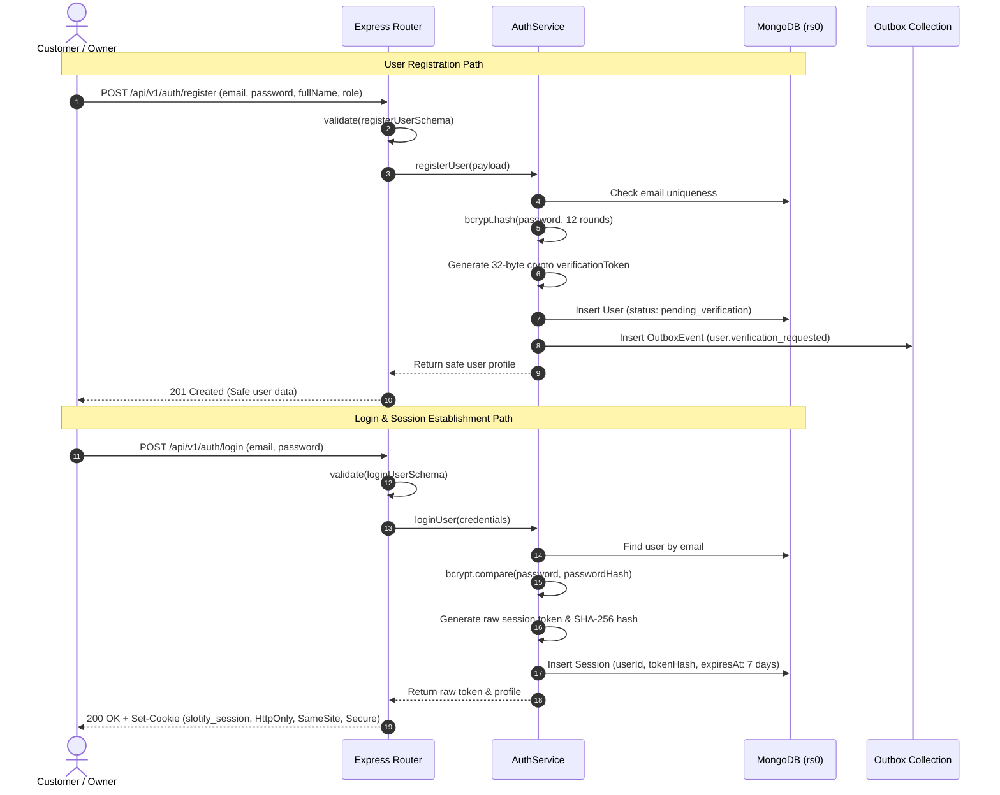
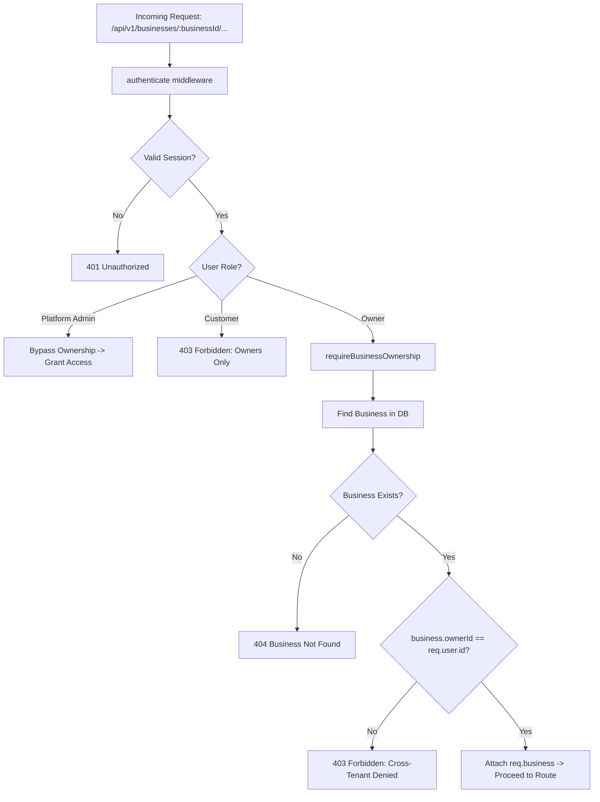

# Phase 01 — Domain, Security & Environment Foundations

**Document:** `docs/implementation-log/phase-01-foundation.md`  
**Phase:** 01 — Domain, Security & Environment Foundations  
**Status:** Completed & Fully Verified  
**Execution Date:** 2026-10-15  
**Lead Engineer:** Antigravity (Lead Full-Stack Engineer)

---

## 1. Phase Objective & Acceptance Criteria

### 1.1 Objective
Establish the foundational core for Slotify in accordance with `docs/implementation-phases.md`. This includes:
1. Setting up the root workspace infrastructure, tooling (ESLint, Prettier, `.gitignore`), and containerized runtime environment (Docker Compose with MongoDB single-node replica set for transactions, RabbitMQ, and Mailpit).
2. Implementing the authoritative domain data contracts and runtime schema validation in pure JavaScript using Zod (`@slotify/shared`).
3. Implementing the Express-based backend API (`@slotify/server`), featuring helmet, CORS, cookie-based session management, password hashing, verification tokens, tenant isolation middleware, and a centralized error envelope.
4. Validating all modules with automated unit and integration tests executed against live replica set databases.

### 1.2 Acceptance Criteria & Status
| Acceptance Criterion | Result | Evidence |
|---|---|---|
| Pure JavaScript throughout (no TypeScript) | **PASSED** | Codebase consists strictly of `.js` files using JSDoc and Zod. |
| Docker Compose stack with Mongo replica set `rs0` | **PASSED** | `rs.status().ok === 1` verified; MongoDB, RabbitMQ, Mailpit healthy. |
| Shared domain schemas validate users, businesses, bookings | **PASSED** | 9 unit tests passing in `@slotify/shared`. |
| Centralized error handling and standard envelope | **PASSED** | Returns `{ success: false, error: { code, message, details, correlationId } }`. |
| User registration, login, logout, and verification routes | **PASSED** | Integration tests pass: HttpOnly session cookie, password hashing, and outbox event creation. |
| Tenant isolation guard prevents cross-tenant access | **PASSED** | Returns 403 when owners attempt cross-tenant access; allows verified owners and platform admin. |
| All tests and linter pass with 0 errors | **PASSED** | 22 tests passing across workspaces; 0 ESLint warnings. |

---

## 2. Files Created & Modified

### 2.1 Workspace Root & Infrastructure
- `.gitignore`: Configured to exclude `node_modules/`, `.env`, builds, coverage, and temporary files.
- `.prettierignore` & `.prettierrc`: Consistent formatting configuration excluding skill reference assets.
- `eslint.config.js`: Flat configuration for ES modules, JSX, and strict unused variable detection.
- `package.json`: Root manifest with npm workspaces (`packages/*`, `apps/*`).
- `.env.example`: Configuration template for ports, replica set URI, RabbitMQ, and session secrets.
- `docker-compose.yml`: Multi-container topology for MongoDB 7 (`rs0` replica set), RabbitMQ 3 (`3.13-management`), and Mailpit.
- `README.md` & `AGENTS.md`: Root entry points directing developers to `docs/` and enforcing project invariants.

### 2.2 Shared Package (`packages/shared`)
- `packages/shared/package.json`: Manifest for `@slotify/shared`.
- `packages/shared/src/index.js`: Barrel export of all domain contracts.
- `packages/shared/src/schemas/common.js`: ObjectId, ISO 8601, email, slug, and IANA timezone validators.
- `packages/shared/src/schemas/user.js`: User registration, login, reset, and safe user profile schemas.
- `packages/shared/src/schemas/session.js`: Session entity schema.
- `packages/shared/src/schemas/business.js`: Business creation, update, and recurring hours schemas.
- `packages/shared/src/schemas/service.js`: Service entity schema with buffer duration and placement.
- `packages/shared/src/schemas/staff.js`: Staff entity schema with shifts, breaks, and leave schedules.
- `packages/shared/src/schemas/booking.js`: Multi-service booking and segment schemas.
- `packages/shared/src/schemas/outbox.js`: Transactional outbox event schema.
- `packages/shared/src/schemas/audit.js`: Append-only audit event schema.
- `packages/shared/src/schemas/restriction.js`: Abuse restriction entity schema.
- `packages/shared/test/schemas.test.js`: Comprehensive unit tests for domain validations.

### 2.3 Server Application (`apps/server`)
- `apps/server/package.json`: Manifest for `@slotify/server`.
- `apps/server/src/config/index.js`: Environment configuration with Zod validation.
- `apps/server/src/db/mongo.js`: MongoClient connection manager with automatic index initialization.
- `apps/server/src/errors/index.js`: Domain error hierarchy (`AppError`, `ValidationError`, `UnauthorizedError`, `ForbiddenError`, `ConflictError`).
- `apps/server/src/middleware/error-handler.js`: Global error handling middleware with correlation IDs.
- `apps/server/src/middleware/validate.js`: Generic Express middleware for Zod schema validation.
- `apps/server/src/middleware/auth.js`: Session cookie extractor, authenticator, and role guards.
- `apps/server/src/middleware/tenant.js`: Strict tenant isolation guard checking business ownership.
- `apps/server/src/services/auth-service.js`: Registration, password hashing (bcryptjs 12 rounds), session creation/revocation, and verification.
- `apps/server/src/routes/auth-routes.js`: Express routes for `/api/v1/auth` (`/register`, `/login`, `/logout`, `/me`, `/verify-email`).
- `apps/server/src/routes/health-routes.js`: Healthcheck and readiness probes (`/health`, `/ready`).
- `apps/server/src/app.js`: Express application factory.
- `apps/server/src/server.js`: HTTP bootstrap with graceful shutdown handlers.
- `apps/server/test/auth.test.js`: Integration tests for auth, verification, and session lifecycle.
- `apps/server/test/tenant.test.js`: Integration tests for cross-tenant rejection and admin access.

---

## 3. Architecture & Data Flow

### 3.1 Authentication & Session Management Flow


### 3.2 Tenant Isolation Architecture


---

## 4. Key Contracts & Validation Rules

### 4.1 Error Envelope Specification
All endpoints adhere to the standard error structure:
```json
{
  "success": false,
  "error": {
    "code": "VALIDATION_ERROR | UNAUTHORIZED | FORBIDDEN | NOT_FOUND | CONFLICT | INTERNAL_SERVER_ERROR",
    "message": "Human readable explanation",
    "details": {},
    "correlationId": "uuid-v4"
  }
}
```

### 4.2 Security Rules Implemented
1. **Password Hashing:** Passwords hashed with `bcryptjs` using 12 salt rounds.
2. **Session Security:** Session tokens are 32-byte cryptographically secure random values (`crypto.randomBytes(32)`). Only the SHA-256 hash of the token is persisted in MongoDB, preventing session hijacking even if the database is exposed.
3. **Cookie Attributes:** Cookies use `HttpOnly: true`, `SameSite: strict` (production) or `lax` (development), `Secure: true` in production, with a 7-day TTL backed by a MongoDB TTL index.
4. **Outbox Asynchrony:** User verification requests write an outbox event atomically. Email dispatch will be performed by background workers without blocking the HTTP write path.

---

## 5. Tests & Verification Summary

### 5.1 Test Execution Results
All tests were executed against the live Docker replica set instance:

```text
> @slotify/shared@0.1.0 test
> node --test

✔ Shared Domain Schemas (9 tests, 0 failures, 28ms)
  - validates a valid customer registration payload
  - rejects short passwords (<8 characters)
  - rejects invalid email addresses
  - validates login input
  - validates a valid slug
  - validates IANA time zones
  - validates business creation payload with defaults
  - validates multi-service booking payload
  - rejects booking with empty segments

> @slotify/server@0.1.0 test
> node --test --test-concurrency=1 test/**/*.test.js

✔ Authentication & Session API Integration Tests (9 tests, 0 failures, 4.5s)
  - POST /api/v1/auth/register: registers customer and creates outbox event
  - POST /api/v1/auth/register: rejects duplicate email with 409 Conflict
  - POST /api/v1/auth/register: rejects short passwords with 400 Validation Error
  - POST /api/v1/auth/verify-email: verifies user email using valid token
  - POST /api/v1/auth/verify-email: rejects invalid verification tokens
  - POST /api/v1/auth/login: authenticates user, returns token, sets HttpOnly cookie
  - POST /api/v1/auth/login: rejects incorrect password with 401 Unauthorized
  - /api/v1/auth/me: retrieves profile with cookie session and logs out
  - /api/v1/auth/me: rejects unauthenticated requests with 401

✔ Tenant Isolation & Authorization Middleware Tests (4 tests, 0 failures, 4.4s)
  - allows business owner to access their own business
  - rejects access when owner attempts to access another business (cross-tenant rejection)
  - rejects customers attempting to access owner business routes
  - allows platform admin to access any business

Total: 22 tests passing, 0 failing.
```

### 5.2 Linter & Formatter Verification
- `npm run lint`: ESLint checked all files with **0 errors and 0 warnings**.
- `npm run format:check`: Prettier verified all code formatting.

---

## 6. Git Commit Log for Phase 01

The following sequential, modular local commits were completed for Phase 01:
1. `927a727 feat(docs): initialize repository documentation and phase 00 audit`
2. `210dfd0 chore(infra): add root workspace config, prettier, eslint, docker-compose and env template`
3. `b8ae822 feat(shared): implement domain models, Zod validation schemas, and unit tests`
4. `8978255 chore(prettier): add .prettierignore and format workspace documents`
5. `9375f29 refactor(shared): remove unused imports and format schema definitions`
6. `a4f88d1 feat(server): initialize Express backend with security headers, mongo replica-set and error handling`
7. `794a7a0 feat(auth): implement user registration, session management, and tenant isolation middleware`
8. `e870146 test(server): add integration test suites for authentication and tenant isolation`

---

## 7. Next Phase Recommendation

With Phase 01 completed and verified, the recommended next phase is **Phase 02: Business Setup and Directory**:
- Owner onboarding flow and profile configuration (description, location, time zone, booking horizon, working hours).
- Public directory endpoints (filter by category, location, date, price) and public business profile by unique slug.
- Verification and platform admin approval gating (unapproved businesses must not be publicly visible).
